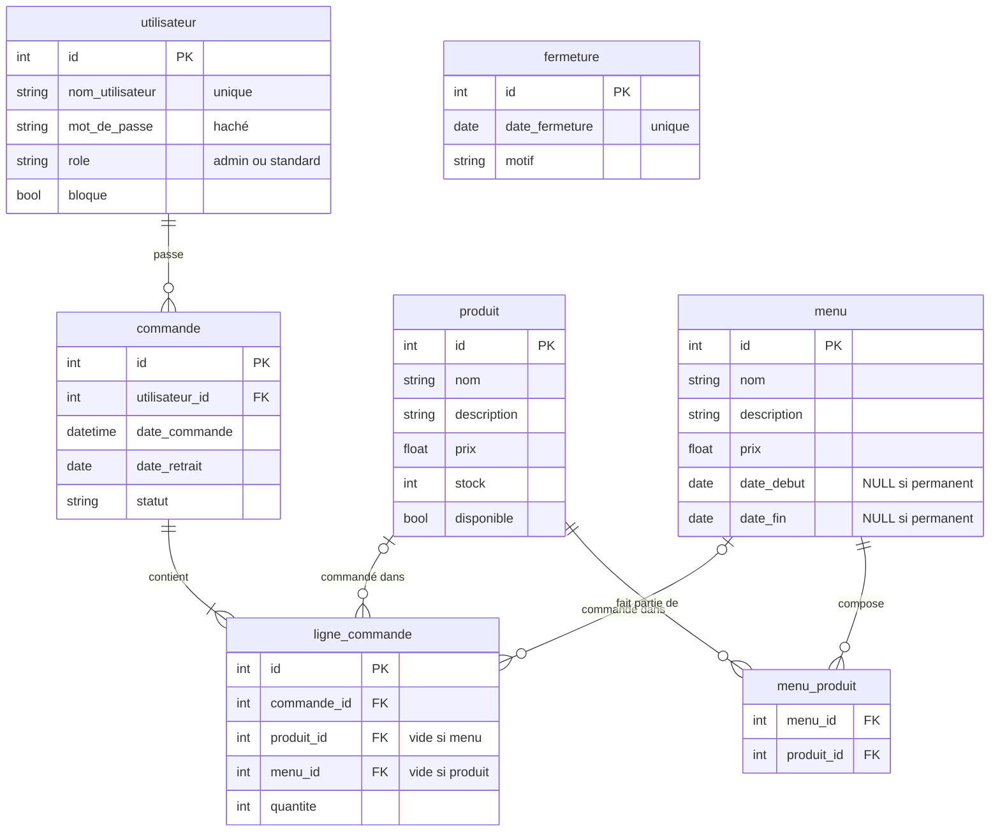

# 4a-isi-projet-db

Base de données SQLite du projet Pol-eat-heck.

## Équipe
- Meina : base de données
- Jude : back-end
- Nour : front-end

## Autres dépôts
- Back : https://github.com/Nour-Bouslimi/4a-isi-projet-back
- Front : https://github.com/Nour-Bouslimi/4a-isi-projet-front

## Contenu du dépôt

- `schema.sql` : création des 7 tables et de leurs contraintes
- `seed.sql` : données de test (utilisateurs, produits, menus, commandes…)
- `init_db.py` : crée le fichier `pol_eat_heck.db` à partir des deux scripts SQL

## Utilisation

Depuis le dossier du dépôt :

```
py init_db.py
```

Le fichier `pol_eat_heck.db` est créé (ou recréé à zéro). Il n'est pas versionné : il se régénère avec cette commande.

⚠️ Relancer le script **efface toutes les données** existantes.

## Conception de la base de données



### Légende du diagramme

Chaque extrémité d'un trait indique **combien** d'éléments sont liés :

- `||` → exactement **1**
- `|o` → **0 ou 1**
- `o{` → **0 ou plusieurs**
- `|{` → **1 ou plusieurs**

Abréviations dans les tables :

- **PK** (clé primaire) → identifie chaque ligne de manière unique
- **FK** (clé étrangère) → fait référence à une ligne d'une autre table

Exemple de lecture : `utilisateur ||--o{ commande`

→ une commande appartient à **1** utilisateur, et un utilisateur peut avoir **0 ou plusieurs** commandes.

## Choix de conception

- **`menu_produit`** : table d'association, car un menu contient plusieurs produits et un produit peut appartenir à plusieurs menus.
- **`ligne_commande`** : chaque ligne contient soit un produit, soit un menu (imposé par une contrainte `CHECK`).
- **Pas de prix total dans `commande`** : il se calcule à partir des lignes ; le stocker créerait une redondance.
- **Menus permanents** : `date_debut` et `date_fin` à `NULL`.
- **`fermeture`** : table indépendante, consultée par comparaison de dates avec `commande.date_retrait`.
- **Types SQLite** : booléens stockés en `INTEGER` (0/1), dates en `TEXT` au format `AAAA-MM-JJ`.

## Notes pour le back-end

- Activer les clés étrangères **à chaque connexion** : `PRAGMA foreign_keys = ON;`
- Les mots de passe de `seed.sql` sont provisoires (`HASH_A_REMPLACER`) : ils devront être remplacés par de vrais hachés, une fois la méthode de hachage choisie.
- Un produit présent dans une commande ne peut pas être supprimé : utiliser plutôt `disponible = 0`.