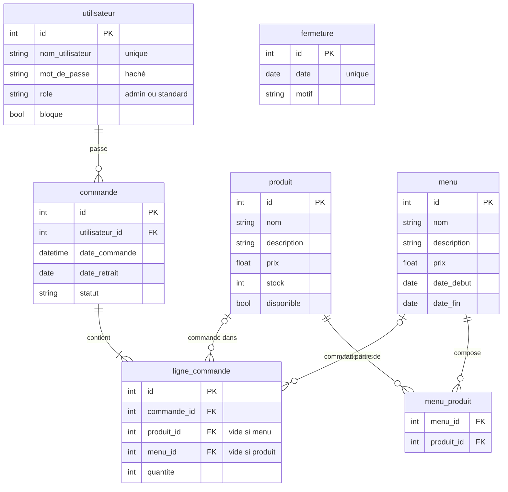

# 4a-isi-projet-db

Base de données SQLite du projet Pol-eat-heck.

## Autres dépôts
- Back : https://github.com/Nour-Bouslimi/4a-isi-projet-back
- Front : https://github.com/Nour-Bouslimi/4a-isi-projet-front

## Conception de la base de données

### Légende du diagramme

Chaque extrémité d'un trait indique **combien** d'éléments sont liés :

- `||` → exactement **1**
- `|o` → **0 ou 1**
- `o{` → **0 ou plusieurs**
- `|{` → **1 ou plusieurs**

Abréviations dans les tables :

- **PK** (clé primaire) → identifie chaque ligne de manière unique
- **FK** (clé étrangère) → fait référence à une ligne d'une autre table

Exemple de lecture : `utilisateur ||--o{ commande`
→ une commande appartient à **1** utilisateur, et un utilisateur peut avoir **0 ou plusieurs** commandes.